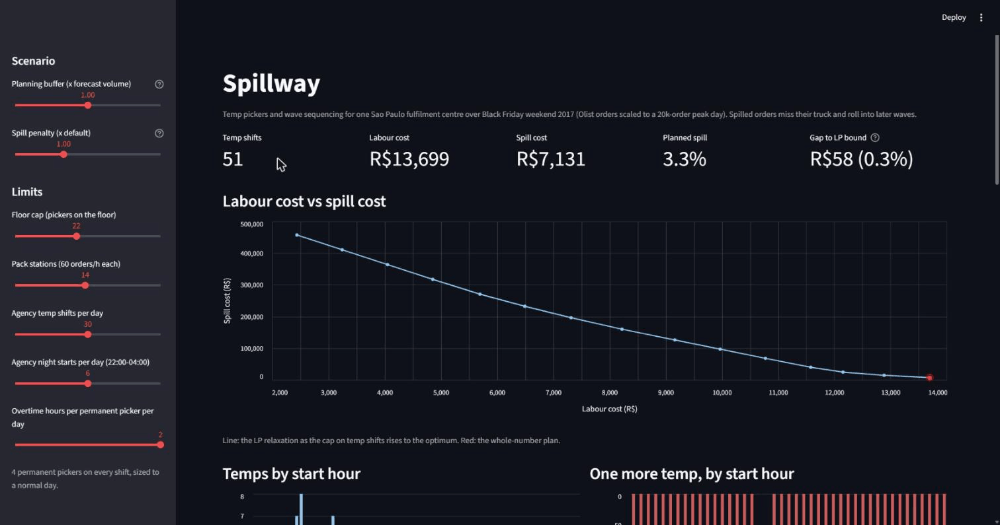

# Spillway

Spillway plans temporary picker staffing and wave sequencing for one fulfilment centre (FC) during a demand peak. It trades labour cost against spillage: orders that miss their picking wave and then their truck. The case is a Sao Paulo FC over Black Friday weekend 2017, built on Olist, a public Brazilian e-commerce dataset.



## The problem

Flipkart's engineering blog frames spillage as orders that miss processing waves and truck connections when capacity runs short, in [The Race Against the Clock: Optimizing Supply Chain Capacity for Faster Deliveries, Part 1](https://blog.flipkart.tech/the-race-against-the-clock-optimizing-supply-chain-capacity-for-faster-deliveries-part-1-01b867c400de) (April 2026). More pickers clear the backlog, at a price. Spillway answers two questions for one FC: how many temps to bring in at each hour, and which orders each wave should pick so the costly ones make their truck.

Flipkart describes the planning platform behind its capacity, inventory and network flow decisions in its 2025 Franz Edelman Award finalist paper: Agarwal, S., Agrawal, P., et al. (2026). Faster, Smarter, Leaner: How Flipkart Optimized Its Supply Chain to Unlock Growth. *INFORMS Journal on Applied Analytics* 56(1):42-57. [doi:10.1287/inte.2025.0282](https://doi.org/10.1287/inte.2025.0282)

Flipkart supplies the problem only. The data is Brazilian, costs are in R$, and nothing is relabelled to India. The method needs order timestamps, destinations and values plus a truck schedule and local costs, so any FC with those inputs can reuse it.

## Data

Orders come from Olist sellers in Sao Paulo state: 60,338 orders after dropping cancelled and unavailable ones and keeping the 8 largest destination states (86% of that volume). Value tiers are order-value terciles, with mean values of R$49, R$121 and R$397 after inflating 2017 prices to 2026 by IPCA (x1.5722).

Volume is scaled x27.1 so Black Friday (24 Nov 2017) holds 20,000 orders. The realised window then has 20,000, 8,005 and 6,920 orders on Friday, Saturday and Sunday.

Two demand series stay separate, since the gap between them is a result:

- The planning forecast uses the four weeks before Black Friday: weekday totals, the hour-of-day shape and the state and tier mix.
- Realised demand is the actual window, smoothed over 3 hours because it holds only about 14 Olist orders an hour before scaling.

Olist has no orders from November 2016, so nothing in the data predicts the 2017 surge. The base case applies hindsight surges (x7.54 on Black Friday, x3.29 on the weekend). That is a perfect volume forecast that still misses the hourly shape: hourly WAPE is 27%, or 79% with no surge. The planning buffer slider sets volume error on top.

## Model

Time runs in hourly waves across the 72-hour window and a 36-hour lookahead. An order arriving in hour a can be picked from wave a+1 and catches the first truck leaving at least an hour (loading) after its wave ends. Its target truck is the one its earliest wave would catch. Departures per state are set back from a 06:00 hub arrival by road distance at 60 km/h, and states under 500 km get two a day.

The staffing model is a linear program in OR-Tools with these variables:

- `h[t]`: temps starting an 8-hour shift at hour t, any hour of the day.
- `x[s, v, k, w]`: orders of state s and tier v with target truck k picked in wave w. Orders sharing a target truck form one queue, since their arrival hour no longer changes the decision.
- `o[w]`: permanent-picker overtime hours in wave w.

It minimises temp shift cost plus overtime cost plus delay cost. Delay is priced per hour between the truck an order catches and its target, at R$10 support cost plus 5% of the order's value for cancellation risk, per day late. Orders still queued at the end of the lookahead cost 60 hours of delay.

Per wave it enforces:

- Picking capacity: 4 permanent pickers at 50 orders/h and temps at 40/h. A permanent picker on overtime takes a floor slot like a temp and adds the 10/h experience gap.
- Floor: at most 22 pickers on the floor. Above 16.5 (75% of the floor) aisles congest and each further temp adds 25/h.
- Packing: at most 840 orders (14 stations at 60/h).
- Agency supply: at most 30 temp starts a day, 6 of them between 22:00 and 04:00.
- Overtime: at most 2 extra hours per permanent picker a day.

Permanent headcount covers a normal day's busiest hour. The floor and the pack line are sized so a full floor covers the design peak day's average hour (20,000 / 24).

Exact branch-and-bound took 20 to 60+ seconds per day on CBC, SCIP and HiGHS. Spillway solves the LP relaxation on GLOP instead, rounds temps up, trims them back under the floor and agency caps, then adds or removes single temps while total cost falls. `Plan.gap` reports the distance to the LP bound: R$58 (0.3%) at default settings, in about half a second.

With temps fixed the same LP re-plans wave assignment and overtime. The simulation's rolling re-plan and the app's what-ifs both use it.

## Results at default settings

The day-before plan books 51 temp shifts and 79 permanent overtime hours for R$13,699 of labour. It expects 3.3% of the window's 34,925 orders to spill, costing R$7,131.

The frontier below caps total temp shifts and re-solves the LP relaxation each time. Each block of about ten temp shifts saves less than the one before: about R$131,000 of spill cost for the first, R$28,000 for the last.

| Temp shifts | Labour cost | Spill cost | Planned spill |
|---:|---:|---:|---:|
| 0 | R$2,437 | R$457,027 | 47.7% |
| 10.2 | R$4,694 | R$326,316 | 37.1% |
| 20.3 | R$6,975 | R$210,430 | 27.7% |
| 30.5 | R$9,485 | R$114,179 | 18.9% |
| 40.7 | R$11,731 | R$35,374 | 15.6% |
| 50.8 | R$13,692 | R$7,081 | 3.3% |

At zero temps the R$2,437 is overtime. No start hour pays back one more temp at the optimum: each loses R$220 to R$260. The planned spill falls on Friday, when the floor is already full, and Saturday or Sunday temps have nothing to catch up.

The simulation runs the same headcount against realised demand with Poisson noise, 5% hourly absence and a 10% spread in pick speed. It compares three ways of choosing what each wave picks. The rolling re-plan re-solves the LP every 2 hours from the real backlog and may change overtime on the day; the other two keep the planned overtime. Means and 95% intervals over 30 runs:

| Policy | Spill rate | Spill cost | Labour cost | Total cost |
|---|---:|---:|---:|---:|
| FIFO | 44.5% ± 1.4% | R$178,306 ± 7,518 | R$13,699 | R$192,005 ± 7,518 |
| Earliest truck first | 15.0% ± 1.5% | R$52,454 ± 6,070 | R$13,699 | R$66,153 ± 6,070 |
| Rolling re-plan | 9.2% ± 1.2% | R$26,928 ± 3,814 | R$13,722 ± 20 | R$40,650 ± 3,830 |

The planned 3.3% becomes 9.2% under the best policy because the forecast's hourly shape is 27% off. FIFO picks the oldest orders first whatever their truck, so orders for the next departure can wait behind orders with hours to spare. The intervals use the normal approximation, about 4% narrower than Student's t at 30 runs.

## What-ifs and the LLM

The app's what-if box takes a sentence such as "Rio truck 45 minutes late and two pickers off sick". An LLM turns it into a scenario with a fixed set of fields:

- demand change by state
- truck delay by state
- temp no-shows
- pack stations down
- permanent pickers absent
- agency and overtime caps
- a penalty multiplier

The parsed change is shown for confirmation. Spillway then re-plans from the chosen hour with shifts that already started kept, and shows before and after figures.

The LLM never produces numbers. Its scenario is validated against a strict schema, and its briefing is rejected if it states a digit the solver did not supply, in which case a template briefing replaces it. The app works with no LLM configured, using four pre-parsed examples. A daily cap of 200 calls protects a shared key.

The client talks to any OpenAI-compatible endpoint. NVIDIA NIM `nvidia/nemotron-3.5-bolt-e4b` and Ollama `qwen2.5:7b-instruct-q4_K_M` both pass the live test set of 13 sentences and a briefing.

## Assumptions and sources

| Assumption | Value | Source |
|---|---|---|
| Temp pay | R$2,110/month | Sao Paulo logistics temp job ads, 2026 (R$2,000 to 2,120) |
| Temp employer cost | 1.8x pay | Assumption: payroll charges and agency fee |
| Supervision | R$4,981/month, 1 per 15 temps | Indeed (Shopee supervisor); CAGED national mean R$4,710. Span is an assumption |
| Induction | 4 paid hours per temp, over 3 shifts | Assumption; NR-18's 4-hour admission training is the nearest rule |
| Permanent pay | R$2,086/month | Indeed median, separador de mercadorias, SP (57 salaries) |
| Permanent employer cost | 1.7x pay | Valor Final, Cora (1.7 to 2.0x) |
| Overtime | +50%, at most 2 h a day | Constitution art. 7 XVI; CLT art. 59 |
| Night premium | +20%, 22:00 to 05:00 | CLT art. 73 |
| Pick rates | 50/h permanent, 40/h temp | Pallite, "KPIs for eaches picking" |
| Crowding | from 75% of the floor, 25/h per extra temp | Assumption |
| Pack rate | 60 orders/h per station | Racklify pack-rate benchmarks |
| Agency supply | 30 starts a day, 6 at night | Assumption |
| Late-order cost | R$10 support and 5% cancellation per day late | Assumption |
| Inflation 2017 to 2026 | x1.5722 | Banco Central SGS series 433 (IPCA) |
| Truck schedule | 06:00 hub arrival, 60 km/h, 150 km in-state haul | Assumption; capital coordinates from IBGE Anuario Estatistico 2024, road circuity 1.26 from IBGE/DNIT distances |
| Simulation noise | 5% hourly absence, 10% pick-speed spread | Assumption |

A day shift costs R$221.94 with supervision and induction, a night shift R$260.78, and an overtime hour R$24.18.

## Running it

```
py -3.12 -m venv .venv
.venv/Scripts/python -m pip install -r requirements.txt
.venv/Scripts/python -m streamlit run app.py
.venv/Scripts/python -m pytest -q
```

The app runs from `data/derived.npz`, the demand arrays it needs at FC scale. To rebuild them, put the orders, customers, order_items and sellers CSVs from [Olist on Kaggle](https://www.kaggle.com/datasets/olistbr/brazilian-ecommerce) in `data/raw/` and run `.venv/Scripts/python -m spillway.data`. With the CSVs present, the app and the data tests use them directly.

To type your own what-ifs, set `LLM_MODEL` and `LLM_API_KEY` (and `LLM_BASE_URL` for a non-NIM endpoint) in `.streamlit/secrets.toml`. Live LLM tests run only when `LLM_MODEL` is set in the environment.

## Limits

- Sorting, docks and truck capacity are not modelled; every truck takes everything that reaches it.
- One FC and one weekend. Capacity is counted in orders, at about 1.14 items each.
- The crowding share, congested pick rate and agency limits have no public source.
- Planning is deterministic. A two-stage stochastic model over demand scenarios is the natural extension.
- The simulation keeps headcount fixed, so it cannot call in extra temps mid-day.
- In what-ifs a permanent picker's absence lasts until midnight, supervision cost is linear in temp-hours, and the 52.5-minute legal night hour is ignored.
- The briefing check catches invented digits only, not spelled-out numbers or a wrong label on a right number.

## Licences

The code is MIT-licensed (see `LICENSE`). The data is Olist's [Brazilian E-Commerce Public Dataset](https://www.kaggle.com/datasets/olistbr/brazilian-ecommerce). It is licensed [CC BY-NC-SA 4.0](https://creativecommons.org/licenses/by-nc-sa/4.0/), so `data/derived.npz`, the hourly demand derived from it at FC scale, carries the same licence and is for non-commercial use.
